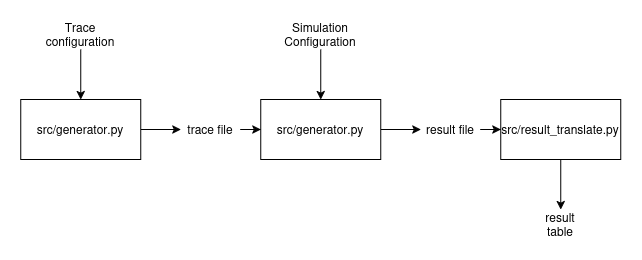
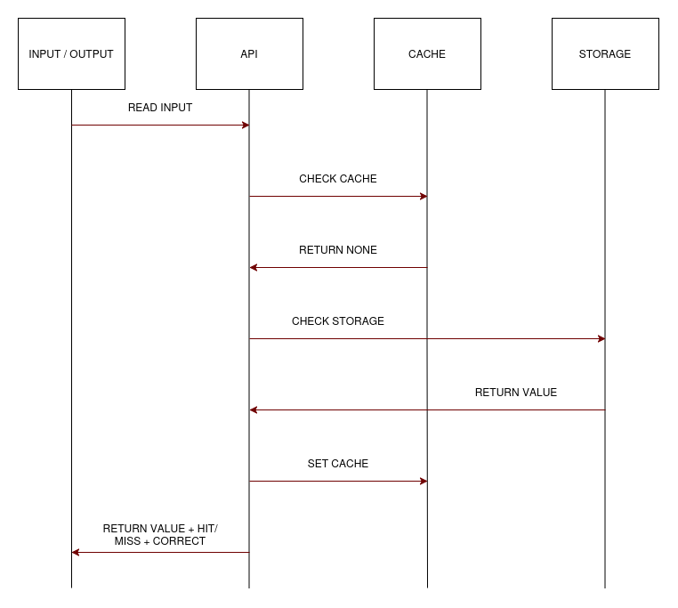
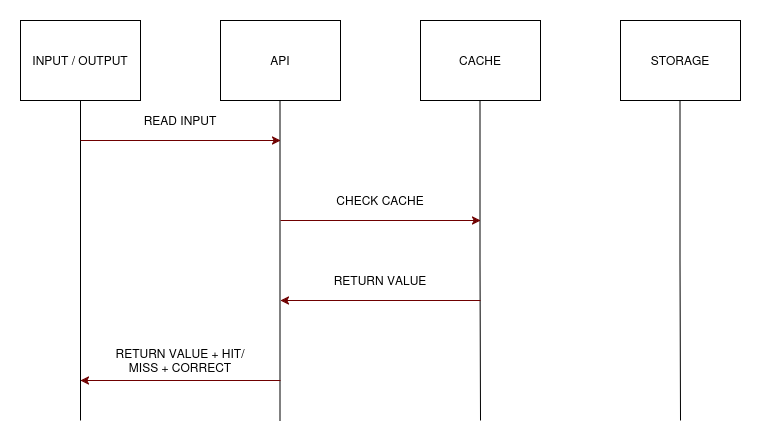
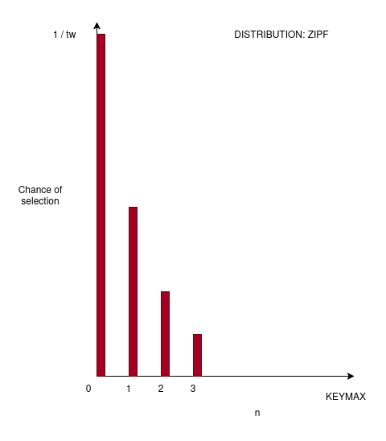
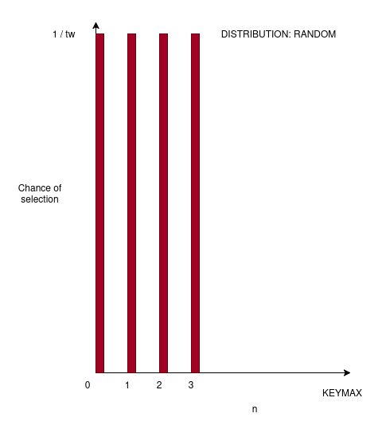

# Introduction
In this paper we take a simulated experimental approach to comparing the cost
and tradeoffs in a `GET/SET` system, The aim is to asses the tradeoffs 
between hard and soft cohesion caching in a reproducible manner that is independent
of underlying systems.

We evaluate two policies for caching, these being push-based eviction and
TTL. And build our assumptions around small write-heavy services in web-applications.
Our underlying assumption through this work is that certain systems might be more
interested in "fresh" data, that is data for which a cache returns the most recently
written value, and we try to highlight some of the potential costs in terms
of cache-hit ratios and a metric of "usefulness" that we argue carries significance
for such systems.

# Related work
We build on our previous work, that is available in the Github repository alongside
the source files for our experiments and simulations. Further several articles
exist, as for instance surveys, case studies and theoretical foundations for
evaluating cache-behavior in different systems. We compliment the existing research
in this field by providing both an overview of the specific question relating to 
concrete "costs" of hard cohesion, evaluating a metric considering both overall cache hit ratios
to the "correctness" of retrieved data, and by providing reproducible results through
simulations.

# Terms and Definitions
A `GET/SET` system is some system in which we can arbitrarily store data using
a `GET` or a `SET` operation. Examples include SQL Databases, NoSQL Databases,
Maps, Dictionaries, Off-the-shelf caching-solutions like memcached, and storage-api's.

In our simulation there are two types of storage, the cache, and the underlying storage.
our underlying storage is some arbitrary `GET/SET` system that will always be correct.
when a `SET` operation is performed, we perform that operation directly on our storage.

when a `GET` operation is performed, this is performed first towards our cache,
the cache then returns whatever entry it holds, or defers to storage if no valid entry is
found, this defering to storage is a **cache miss**, the inverse is a **cache hit**.
our cache-hit-ratio is defined as the number of cache hits over all `GET` operations.

each item is stored alongside some key, and can be retrieved using that same key.
we consider the "correctness" of our data to be a binary question. if a `GET` operation
on some key provides the most recent data that was supplied in a `SET` operation;
our data is correct. the ratio of correct keys from `GET` operations over all 
`GET` operations is considered the **freshness** of a system.

The **usefulness** of our system is defined as the number of correct cache hits.
and is calculated given `FRESHNESS * HIT-RATIO`. 

a write-heavy service is assumed to be a service in which at least 30% of the
`GET` and `SET` operations are `SET` operations \[1].

# Design and implementation

Our simulation encapsulates a "core", consisting of an arbitrary `GET/SET` api
with some cache implementation, and the experimental pipeline consists of constructing
a pregenerated access-pattern or trace, feed this into our simulation core, and then
reporting the status of each request as it occurs.

The entire experiment is a collection of generating traces, benchmarking each trace
and generting the relevant reporting, before accumulating our ouputs, calculating our
relevant metrics and presenting them in a final result table.



## Simulation Core

Our simulation core represents an API receiving requests to either **read** or **write**
(`GET` or `SET`) some data to a givven key. we assume that the core has arbitrary keyspace in the
form of a givven integer numerical value. that is, any whole integer functions as a valid key,
and the core simulation does not impose any restrictions on what number is or isnt a valid key, nor
do we impose that there is a limited number of keys permissable.

we provide the core with a **throughput rate** which is the number of requests it is assumed to simulate
per seconde, every time our simulation processes a request it keeps track of the simulated time by incrementing
a "timer", which is a floating number representing the number of seconds passed, this allows us to
simulate any givven rate of throughput without regarding the real runtime of our simulation.

the core reads an input file line by line, in the format `OPERATION KEY VALUE` and performs the givven operation,
on a `SET` or write operation, it will inform the cache of eviction for the givven key, (eviction can be ignored, as is the case for TTL)
before it writes the key to the underlying storage. On a `GET` or read operation, the api first asks the cache
for the givven key, if the cache returns `None` indicating that the key was not found the storage is asked to retrieve
the key, when a key is retrieved from storage it is also written into the cache, so that the cache can hold
the relevant data next time the cache is asked for it.





As shown in \[Figure 2] and \[Figure 3] we see that a cache hit fully avoids touching underlying
storage. our simulation aims to "behave as if" this was the case, however for the purposes of reporting
correctness it is important to note that we in reality compare the value in our cache with that of the underlying
storage. this means; the behaviour we aim to represent through our simulation is not accurate to the behavior
our simulation is performing. but the overall data-flow does in the general case show the equivalent properties
with regards to what data is in the cache.

**TTL Caching:** our simulation is ran using two caching strategies, in which one of these
is the familiar TTL cache, in TTL Caching a cache entry is valid for a set duration and has some
temporal state. when we execute a `GET` operation towards a TTL cache we also provide a simulated time.
if a key is found we compare the current time according to our simulation with the expiration of the cache
entry. If the cache entry has an expiration less then the simulated time we discard the entry and return a `None`
value, indicating that the cache no longer has any data relevant to our key.

in a `SET` operation our TTL cache enters data into the cache, alongside a timestamp for when this cache entry
expires, which is defined to be the current simulation time pluss some lifteime indicating how long the cache
is valid after entry. we previously mentioned that our API sends an `EVICT` request on write, the TTL Cache implements
this method for polymorphism such that the API can be cache agnostic, but does not provide any functionality within
the method. calling `EVICT` for some key on our TTL cache does in no way modify the state of the cache.

**PUSH EVICT Caching:** Is our hard cohesion caching strategy. keys do not expire, and any passed variable relating to
time is considered irrelevant for this strategy, instead it keeps all keys in cache until they are manually evicted by
the API, which happens when the api executes a `SET` or write against the underlying storage.

## Trace Generation

In order to generate reproducible traces we precompute these from fixed seeds.
from the github repository associated with our work a generator can be found in 
`src/generator.py`. we accept two primary access patterns, a write-ratio givven as a floating point
number in the range \[0..1], a maximum integer for valid keys, a specified number of accesses or requests to generate
and a random seed to use for generation.

our two access patterns or distributions are related to the distribution of keys. and can either be `RANDOM` or `ZIPF`.
Random selects keys at random in the range \[0..KEYMAX] where each key has `1/KEYMAX` chance of beeing selected. Zipf
follows a power-law distribution in which the chance for any key to be selected is by `w / tw` where w is the weight of a single key and tw
is the total weight of all keys. further w is givven as `w(n) = 1/(n+1)` for each `n` in  \[0..KEYMAX], and `w(0) = 1`.





# Limitations

There are a handful of limiting factors the reduce the applicable scope of our work.
While these factors dent necessarily decrease the merit of the overarching patterns
we see given the context of our simulation, they are definitely factors worth
considering both for future work and when attempting to translate the results into
decisions regarding real world systems.

## Real System impacts
A real world implementation of server side in-memory caching as a service-accelerator \[2]
could presumably run for periods of times in the order of months, with varying loads
of traffic during this period. if that is the case our TTL example is no longer representative,
our simulation assumes a continuous stream of requests in which the processing time is equal
for every request regardless of a cache hit or a cache miss. further we have defined our
configuration values for TTL lifetimes in regards to the total duration of our simulation.
setting them at 25%, 50% and 100% respectively. These values help indicate a pattern
of decreasing freshness as the TTL increases, but does not shed light on what happens
with relatively short lifetimes in services. if for instance a cache entry was valid for 3 seconds
in a cache system that ran for several months with "high traffic".

## Simulated time
Simulated time does not clearly and accurately represent real time, that is to say
when evaluating the feasibility of a caching scheme such as PushEvict against TTL our
measurements alone are not sufficient to state that one provides a clear benefit in terms
of latency compared to the other. access-delay for underlying storage, and the time to
read from and populate the cache, may differ across several services and these times must
be accounted for in each individual case in order to gain a clear picture of what 
the presented data means for any given system.

## Keyspaces and "keymax"
We use the term keymax to determine the largest allowed key, and state that all
keys exist in the range `[0..KEYMAX]`. real world systems might provide other 
mechanisms such as hashing to allow arbitrary keys, and could be bound by either a
configuration-provided maximum capacity or utilize an entire systems available storage
to provide lookups for given keys. that is to say the size of a systems storage and
its underlying mechanism for determining how many entries it permits might differ
drastically from our assumptions.

## PushEviction and the promise of freshens
We assume that requests are sequential and ordered, in particular this
might be challenging our notion of freshness for the PushEvict strategy. 
in particular that is the case for any system processing requests with some 
degree of concurrency or parallelism. For example; if a service is available 
over a network  the ordering of network requests might not be arriving in the 
order they were sent. in this situation we could imagine a scenario where:

```
A sends a WRITE
B sends a READ
B gets a HIT
A's write is committed and the cache is updated
```

in a sequence such as that above we can no longer claim that B receives a cache-value
that reflects the latest issued write. from A's perspective, B received a hit with stale
data. this could skew the meaning of "usefulness" in certain environments.

# Results and discussion

The results can be seen in the associated GitHub repository, under `docs/results.txt`
or generated running the provided tracer `src/tracer.sh`.
We assume that the reporting and summary of results might differ by a small margin 
between different host systems as a result in variations
regarding how the host running the simulation handles floating point arithmetic.
From our results we notice some interesting key details that might be worth
further study or consideration.

## TTL lifetimes and keyspace
* for limited keyspaces (`keymax = 100`), we see that our TTL cache has
very similar performance when measured in percentage-points in terms of "usefulness".

* for distirbutions favouring a smaller subset of keys following our power-law distribution
(`zipf`) we notice a similar behavior as we do in the point above.

* Looking at keyspaces of 10,000 keys we see that as our TTL duration increases, the freshness
of a key decreases.

* Comparing keyspaces of 10,000 keys for TTL caches between `random` and `zipf` distribution
we notice that our summary shows a higher usefulness in the `random` case

We assume that given the goal of optimizing for usefulness in a TTL caching system
with a high (> 30%) write-ratio; it would be optimal to prioritize short lifetimes
over a large subset of keys to reduce the number of READS of any given key, and the enable
some mechanism that prevents any one key or subset of keys from being the concentrated
target of READ operations.

Or in other terms; a rapidly changing small set of data will be poorly represented 
by a system utilizing time-invalidation for cohesion if we care about retrieving 
the most recent data.

## TTL as a means of reducing access delays
* The worst hit-ratio for a TTL cache seems to be givven a `random` distribution
with a 70% write-ratio over a space of 10,000 keys. and sits at ~86.8%

* The best hit-ratio for a PushEvict cache seems to be givven a `random` or `zipf` distribution
with a 30% write-ratio over 100 keys. and sits at ~70%

* hit-ratios for TTL caches increase when the keyspace is dense or the accessed keys
are clustered by a power-law distribution (`zipf`).

* hit-ratios for TTL caches seem to increase in relation to the lifteime of the TTL
cache entry.

Given the above points we make the assumption that TTL caching is favourable if
we care about reducing the overall delay to a service, provided that access-delays
can be expressed as `(hit-ratio * cache-delay) + ((1 - hit-ratio) * storage-delay)`

that is, if the cache-delay provides a significant benefit over accessing the underlying
storage and we only care about our delay, a long-lived TTL entry is assumed to be optimal
over the PushEvict strategy.

## PushEviction and usefulness
We note that usefulness for a PushEviction strategy will, givven the limitations
of our simulation, be equivalent to its hit-ratio,

* the hit-ratio and usefulness of a PushEvict strategy doest not show signs of 
signifcant change as they keyspace changes

* the hit-ratio and usefulness of a PushEvict strategy doest not show signs of 
signifcant change as they pattern of access (`random` or `zipf`) changes.

* the hit-ratio and usefulnes of a PushEvict strategy seems correlated to the 
write-ratio of the underlying system

* The usefulness of a push-evict system is in the worst case just below 30%.
this is the case for a write-ratio of 0.7.

* The best case usefulness for a TTL strategy is ~13.3% given a keyspace of 10,000,
a write-ratio of 0.3 and a `random` access pattern with a window of 250,000.

This indicates to us that while the PushEvict strategy is highly dependent on
the write-ratio for a system, it will provide a higher degree of usefulness then
a TTL caching strategy would, assuming we care about ensuring that our data aligns
with the values present in underlying storage, further a 30% hit-ratio could
provide some level of improvement in terms of access times given the previously
stated formula of : `(hit-ratio * cache-delay) + ((1 - hit-ratio) * storage-delay)`
if we assume that cache-delay is less than the storage-delay.

## Further work
It is assumed that we could increase the usefulness of a hard cohesion caching
strategy further if we instead of PushEviction performed a PushWrite, in which
we not evict the cache-data but instead overwrite it with the updated values to
ensure that our cache is synchronized against our storage. This would be dependent
on timing-factors that might be specific to a given system or subsets of systems.

# Conclusion

In this paper we discuss the implementation, experiments and results from simulating
and comparing two different caching strategies in order to better outline the tradeoffs
between hard and soft cohesion. we explain our metric of "usefulness" and showcase
how it correlates not only to the cache-hit ratio but also to the data stored in cache
and how it relates to the underlying storage.

we discuss our results and evaluate systems in which either cohesion strategy is useful,
and provide our source-code, including the simulator and experiments in a public GitHub
repository.


# Sources

* The reletad github repository is available at <https://github.com/ThomasTekie00/INF-2204_TT_SG>

\[1] twemcached - twitter paper
\[2] jia weng - survey