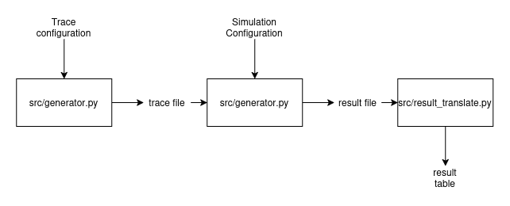
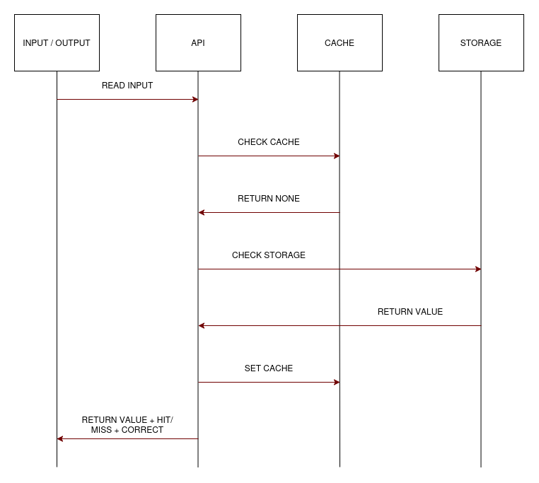
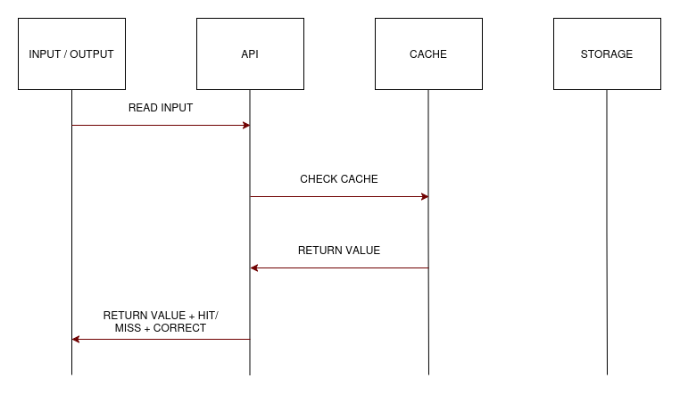
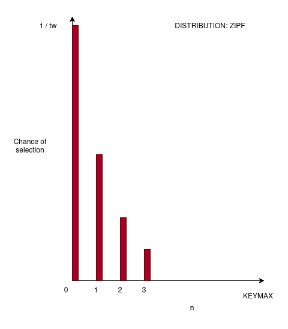
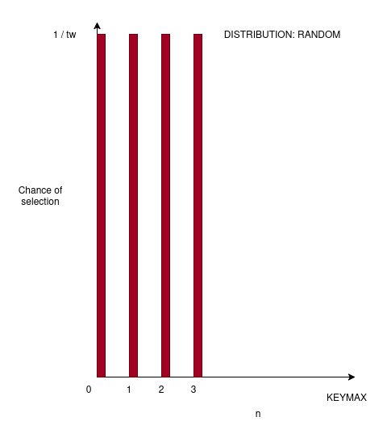

# Introduction
In this paper we take a simulated experimental approach to comparing the cost
and tradeoffs in a `GET/SET` system, The aim is to asses the tradeoffs 
between hard and soft cohesion caching in a reproducible manner that is independent
of underlying systems.

We evaluate two policies for caching, these being push-based eviction and
TTL. And build our assumptions around small write-heavy services in web-applications.
Our underlying assumption through this work is that certain systems might be more
interested in "fresh" data, that is data for which a cache returns the most recently
written value, and we try to highlight some of the potential costs in terms
of cache-hit ratios and a metric of "usefulness" that we argue carries significance
for such systems.

# Related work
We built on our previous work, that is available in the GitHub repository alongside the source files for our experiemnts and simulations. Further several articeles exist, as for instance surveys, case studies and theoretical foundations for evaluation cache behaviour in different systems. We compliment the existing research in this field by providing both an overview of the specific question relating to concrete "costs" of hard cohesion, evaluating a metic considering both overall cache hit ratios to the "correctness" of retrieved data, and by providing reproducible results through simulations.

# Terms and Definitions
A `GET/SET` system is some system in which we can arbitrarily store data using
a `GET` or a `SET` operation. Examples include SQL Databases, NoSQL Databases,
Maps, Dictionaries, Off-the-shelf caching-solutions like memcached, and storage-api's.

In our simulation there are two types of storage, the cache, and the underlying storage.
our underlying storage is some arbitrary `GET/SET` system that will always be correct.
when a `SET` operation is performed, we perform that operation directly on our storage.

when a `GET` operation is performed, this is performed first towards our cache,
the cache then returns whatever entry it holds, or defers to storage if no valid entry is
found, this defering to storage is a **cache miss**, the inverse is a **cache hit**.
our cache-hit-ratio is defined as the number of cache hits over all `GET` operations.

Each item is stored alongside some key, and can be retrieved using that same key.
we consider the "correctness" of our data to be a binary question. if a `GET` operation
on some key provides the most recent data that was supplied in a `SET` operation;
our data is correct. the ratio of correct keys from `GET` operations over all 
`GET` operations is considered the **freshness** of a system.

The **usefulness** of our system is defined as the number of correct cache hits, and is calculated given FRESHNESS * HIT-RATIO.

a write-heavy service is assumed to be a service in which at least 30% of the
`GET` and `SET` operations are `SET` operations \[1].

# Experimental Setup
Our simulation has a core, which is a GET/SET API with a cache in front of it. The experiment works in three steps: we generate a trace of requests in advance, feed it to the core, and log the result of each request as it happens.

The entire experiment is a collection of generating traces, benchmarking each trace and generating the relevant reporting, before putting together our results, calculating our relevant metrics and presenting them in a final result table.

# Design and implementation

Our simulation encapsulates a "core", consisting of an arbitrary `GET/SET` api
with some cache implementation, and the experimental pipeline consists of constructing
a pregenerated access-pattern or trace, feed this into our simulation core, and then
reporting the status of each request as it occurs.

The entire experiment is a collection of generating traces, benchmarking each trace
and generting the relevant reporting, before accumulating our ouputs, calculating our
relevant metrics and presenting them in a final result table.

## Simulation Core

Our simulation core represents an API receiving requests to either **read** or **write**
(`GET` or `SET`) some data to a givven key. we assume that the core has arbitrary keyspace in the
form of a given integer numerical value. that is, any whole integer functions as a valid key,
and the core simulation does not impose any restrictions on what number is or isnt a valid key, nor
do we impose that there is a limited number of keys permissable.

we provide the core with a **throughput rate** which is the number of requests it is assumed to simulate
per seconde, every time our simulation processes a request it keeps track of the simulated time by incrementing
a "timer", which is a floating number representing the number of seconds passed, this allows us to
simulate any givven rate of throughput without regarding the real runtime of our simulation.

The core reads an input file line by line, in the format `OPERATION KEY VALUE` and performs the givven operation,
on a `SET` or write operation, it will inform the cache of eviction for the givven key, (eviction can be ignored, as is the case for TTL)
before it writes the key to the underlying storage. On a `GET` or read operation, the api first asks the cache
for the givven key, if the cache returns `None` indicating that the key was not found the storage is asked to retrieve
the key, when a key is retrieved from storage it is also written into the cache, so that the cache can hold
the relevant data next time the cache is asked for it.

As shown in \[Figure 2] and \[Figure 3] we see that a cache hit fully avoids touching underlying
storage. our simulation aims to "behave as if" this was the case, however for the purposes of reporting
correctness it is important to note that we in reality compare the value in our cache with that of the underlying
storage. this means; the behaviour we aim to represent through our simulation is not accurate to the behavior
our simulation is performing. but the overall data-flow does in the general case show the equivalent properties
with regards to what data is in the cache.

**TTL Caching:** our simulation is ran using two caching strategies, in which one of these
is the familiar TTL cache, in TTL Caching a cache entry is valid for a set duration and has some
temporal state. when we execute a `GET` operation towards a TTL cache we also provide a simulated time.
if a key is found we compare the current time according to our simulation with the expiration of the cache
entry. If the cache entry has an expiration less then the simulated time we discard the entry and return a `None`
value, indicating that the cache no longer has any data relevant to our key.

in a `SET` operation our TTL cache enters data into the cache, alongside a timestamp for when this cache entry
expires, which is defined to be the current simulation time pluss some lifteime indicating how long the cache
is valid after entry. we previously mentioned that our API sends an `EVICT` request on write, the TTL Cache implements
this method for polymorphism such that the API can be cache agnostic, but does not provide any functionality within
the method. calling `EVICT` for some key on our TTL cache does in no way modify the state of the cache.

**PUSH EVICT Caching:** Is our hard cohesion caching strategy. keys do not expire, and any passed variable relating to
time is considered irrelevant for this strategy, instead it keeps all keys in cache until they are manually evicted by
the API, which happens when the api executes a `SET` or write against the underlying storage.

## Trace Generation

In order to generate reproducible traces we precompute these from fixed seeds.
from the github repository associated with our work a generator can be found in 
`src/generator.py`. we accept two primary access patterns, a write-ratio givven as a floating point
number in the range \[0..1], a maximum integer for valid keys, a specified number of accesses or requests to generate
and a random seed to use for generation.

our two access patterns or distributions are related to the distribution of keys. and can either be `RANDOM` or `ZIPF`.
Random selects keys at random in the range \[0..KEYMAX] where each key has `1/KEYMAX` chance of beeing selected. Zipf
follows a power-law distribution in which the chance for any key to be selected is by `w / tw` where w is the weight of a single key and tw
is the total weight of all keys. further w is givven as `w(n) = 1/(n+1)` for each `n` in  \[0..KEYMAX], and `w(0) = 1`.

## Warmup
We do not use a warmup period. Every run starts with an empty cache, so cold start is part of what we measure and all reads are counted. The first read of each key is therefore always a miss, which gives at most N misses per trace. With 1 000 000 accesses this is at most 1.4% of the reads at N = 10 000 and a write ratio of 0.3 

# Results and discussion

# Limitations
* not representative of a real system
* simulated runtime != real runtime on hardware
* limited key space to force reuse, real systems have larger key-sizes
* assumes continous time, does not regard the fact that some requests take longer than others.
* assume single threaded, does not regard concurrency

# Conclusion

# Sources

* The reletad github repository is available at <https://github.com/ThomasTekie00/INF-2204_TT_SG>

\[1] twemcached - twitter paper
